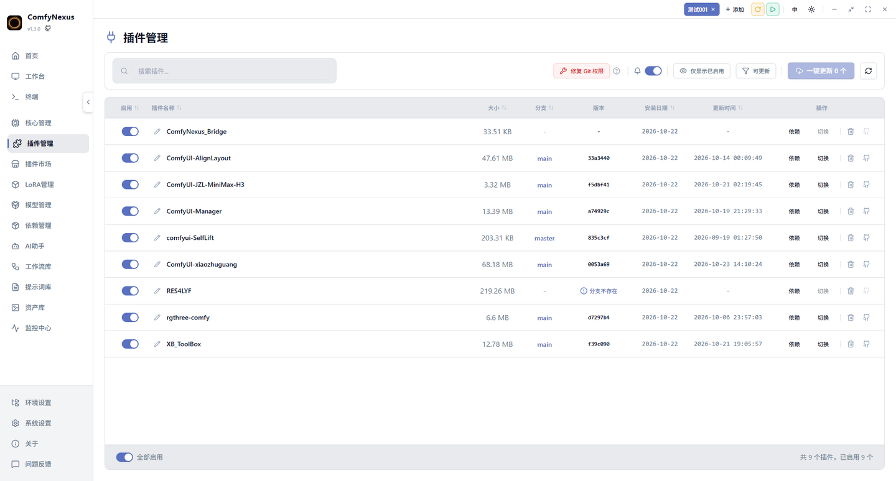
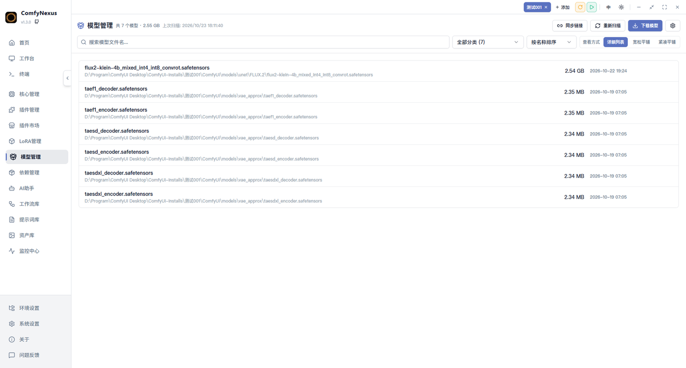
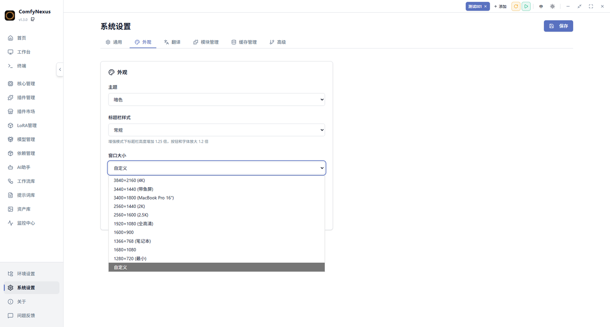
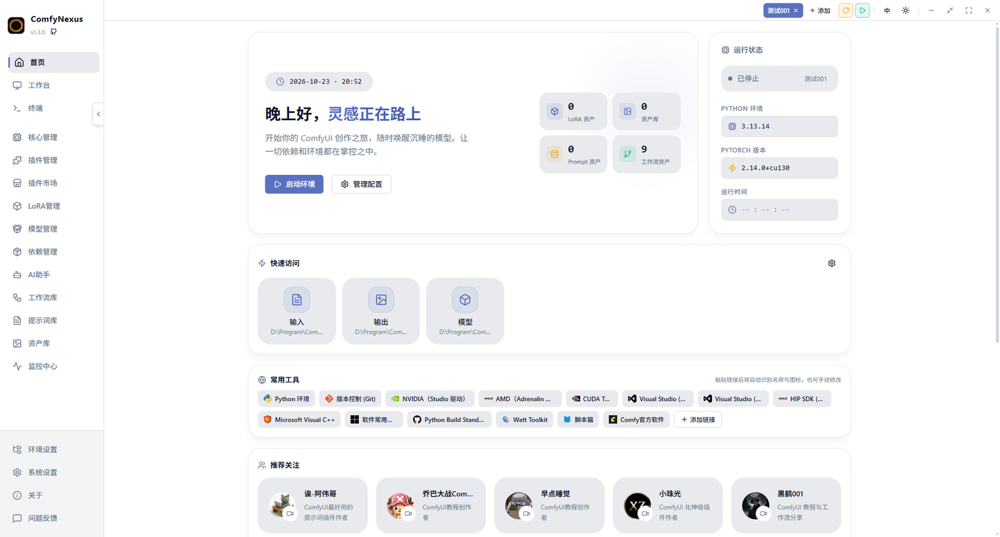
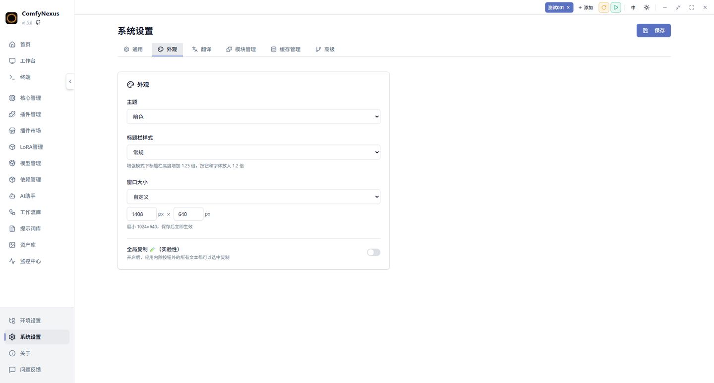

<h1>ComfyNexus</h1>

<strong>为专业创作者而生的 ComfyUI 现代化管理平台</strong>

<em>本仓库基于原项目 <a href="https://github.com/Allen-xxa/ComfyNexus">Allen-xxa/ComfyNexus</a> 的 v1.2.6 继续开发，当前版本 <strong>v1.3.0</strong>，原作者及原始更新日志完整保留。</em>

  
  
  
  

  <a href="#-v130-新特性">v1.3.0 新特性</a> •
  <a href="#-界面预览">界面预览</a> •
  <a href="#-功能全景">功能全景</a> •
  <a href="#-快速开始">快速开始</a> •
  <a href="#-常见问题">常见问题</a>

---

## 🆕 v1.3.0 新特性

本版本在原仓库 v1.2.6 基础上新增 **模型管理** 完整模块，并完成多项体验优化。

### 📦 模型管理（全新模块）

| 能力 | 说明 |
|:---|:---|
| **本地模型库** | 扫描环境 `models/` 全部子目录（checkpoints / loras / vae / controlnet / text_encoders …），统一列表管理 |
| **多源网络下载** | 自动识别 HuggingFace / HF-Mirror / ModelScope / Civitai / 任意直链，失败自动切国内镜像重试，断点续传 + 统一下载缓存 |
| **网络链接同步** | 一键为本地模型匹配网络下载地址：**默认魔搭社区优先，搜不到再用 HuggingFace** |
| **默认链接源可切换** | 魔搭社区 / HuggingFace / 自动（魔搭优先）三种策略随时切换 |
| **单文件手动关联** | 每个模型可单独打开关联弹窗，默认展示魔搭与 HF 上匹配到的候选链接供直接点选，也可手动输入任意下载链接 |
| **多文件夹管理** | 本地模型目录支持多路径配置、逐个开关；**清空即不显示**，输入哪些就只显示哪些 |

### 🔌 插件管理

- **新增「大小」列** — 插件名称后展示插件文件夹占用总大小（不含 `.git` 内部对象），支持按大小排序

  

### 🗂 模型库界面

  

### 🪟 窗口与界面

- **窗口任意缩放** — 四角 **+ 四条边** 均可拖动调整大小，不再只能拖角；最小窗口放宽至 **1024×640**
- **常用尺寸预设** — 「系统设置 - 外观 - 窗口大小」新增 4K / 带鱼屏 / 2K / 全高清 / 笔记本等 **9 组**常见分辨率

  

### 🚀 0 基础安装

- 安装步骤重排：注意力 → 大模型 → 插件 → 工作流 → 自定义工作流 → 依赖
- 依赖滚动展示当前正在安装的包；进度按字节总量计算，多文件并行不再跳变
- 工作流多源下载（单链接优先、慢速换源，最多回退 10 个源，全失败自动跳过）

### 🧩 LoRA 管理

- 本地文件夹多路径设置、逐个开关与删除
- 新增「刷新」按钮，磁盘变动后可一键重新同步
- 空路径可保存

---

## 🖼️ 界面预览

### 首页

  

### 外观设置

  

---

## 🚀 功能全景

### 🏠 首页

- **ComfyUI 状态卡片** — 实时显示运行状态、运行时间、端口占用、Python/PyTorch 版本
- **文件夹快捷栏** — 内置常用目录入口，支持自定义收藏
- **快捷访问 / 常用工具 / 推荐关注** — 全部本地持久化，重启不丢

### 🖥️ 工作台

- **WebView 原生体验** — 在应用内直接操作 ComfyUI 界面
- **全屏模式** — 一键进入沉浸式全屏，标题栏自动隐藏
- **智能图片下载** — 右键保存图片，自动记忆路径

### 📟 实时终端

- **日志实时推送** — ComfyUI 进程输出实时同步
- **Traceback 智能识别** — 自动捕获 Python 异常堆栈，高亮显示

### 🔄 核心版本管理

- **稳定版/开发版切换** — 自由切换 ComfyUI 版本
- **分支管理** — 一键切换分支或回退到指定提交
- **Git 权限修复** — 一键检测并修复 Git 仓库权限问题

### 🔌 插件管理

- **已安装插件一览** — 名称、分支、版本、更新状态、**文件夹大小**
- **一键更新** — 单个或批量更新，更新前自动备份
- **分支切换 / 启用禁用 / 依赖变化追踪**

### 🏪 插件市场

- **三级缓存加速** — 首屏加载 <100ms
- **一键安装** — 从 GitHub 仓库一键安装插件
- **安装前依赖检查** — 自动检测依赖冲突，提前预警

### 📦 模型管理

- **本地模型库** — 全部分类目录扫描与管理
- **多源网络下载** — 5 类下载源自动识别，断点续传
- **网络链接同步** — 魔搭优先，无则 HuggingFace
- **手动关联** — 单模型指定候选或手填链接

### 📦 依赖管理

- **依赖树可视化** — 以树形结构展示所有 Python 依赖
- **冲突检测** — 自动检测版本冲突，高亮标记严重程度
- **缺失依赖一键安装** — 支持国内 PyPI 镜像源加速

### 🛟 救援模式

- **环境快照备份** — 一键创建快照，可选择备份范围
- **智能回滚** — 一键恢复到任意历史快照
- **进程安全检查** — 回滚前自动检测 ComfyUI 运行状态

### 🎨 LoRA 管理

- **模型自动扫描** — 自动识别模型文件与格式
- **Civitai 深度同步** — 自动抓取模型元数据、预览图及触发词
- **智能分类** — 按 FLUX/SDXL/SD1.5 等架构自动归档

### 🤖 AI 助手

- **多模型对接** — 支持 OpenAI、Claude、智谱、讯飞星火、火山引擎、Ollama 等
- **联网搜索 / 深度思考 / 文件与图片分析 / 报错日志分析**

### 🔗 工作流管理

- **工作流导入解析** — 导入 JSON 文件，自动解析节点与连接
- **插件依赖检测** — 自动识别所需第三方插件
- **缺失插件一键安装** — 一键批量安装缺失插件

### 📝 提示词管理

- **提示词库** — 创建和管理常用提示词模板
- **分类树结构** — 树形结构组织，支持多级分类

### 🖼️ 资产库

- **输出图片浏览** — 瀑布流展示生成作品
- **NSFW 过滤** — 内置 ONNX 模型自动识别
- **批量操作** — 批量选择、删除、移动、分类

### 📊 监控中心

- **CPU/GPU 监控** — 实时追踪温度、使用率、功耗
- **内存/磁盘/网络监控** — 实时显示使用量与速率

### 🌐 环境管理

- **多环境支持** — 创建和管理多个 ComfyUI 环境
- **性能预设** — 内置 Flux 标准、旗舰画质、老显卡救星等预设
- **自定义参数** — 支持多行参数编辑
- **外置模型路径** — 支持自定义模型目录映射

### ⚙️ 系统设置

- **GitHub/PyPI/HuggingFace 镜像加速** — 解决国内网络访问问题
- **代理设置** — 支持 Git、pip、AI 请求等全链路代理
- **模块管理** — 自定义启用/禁用功能模块，侧边栏拖拽排序
- **窗口大小预设** — 9 组常用分辨率，四角四边自由缩放
- **自动更新** — 应用启动时自动检查新版本

---

## 📥 快速开始

### 系统要求

| 项目 | 要求 |
|:---|:---|
| 操作系统 | Windows 10/11（已内置 MinGit 2.53.0） |
| Python | 3.12+ |
| GPU | NVIDIA（CUDA 支持） |

### 安装步骤

1. **下载** 最新 [Releases](https://github.com/renxingblack/ComfyNexus/releases) 压缩包或安装包
2. **安装版**：运行 `ComfyNexus-v1.3.0-setup.exe` 按向导完成
   **绿色版**：解压后直接运行 `ComfyNexus.exe`
3. 首次启动选择你的 ComfyUI 根目录即可

---

## ❓ 常见问题

<b>需要手动安装 Git 吗？</b>

**完全不需要**。ComfyNexus 内置 MinGit 2.53.0，自动处理所有版本控制任务。

<b>支持多开吗？</b>

**支持**。可以在环境设置里添加多个环境并分配不同端口（如 8188, 8189），实现多实例并行运行。

<b>模型下载支持哪些源？</b>

HuggingFace（自动走国内镜像重试）、ModelScope 魔搭社区、Civitai、任意直链。
在国内建议保持默认链接源为**魔搭社区优先**。

<b>AI 助手支持哪些模型？</b>

支持 xflow API 聚合平台、OpenAI（GPT-4）、Claude、智谱 GLM、讯飞星火、火山引擎、Ollama 本地模型等主流 AI 服务。

---

## ☕ 支持作者

如果 ComfyNexus 对你有帮助，欢迎请作者喝杯咖啡

---

## 🙏 致谢与许可

本项目基于原项目 [Allen-xxa/ComfyNexus](https://github.com/Allen-xxa/ComfyNexus)（MIT 协议）继续开发，
原作者为 Allen-xxa，原始仓库地址、版权声明与历史更新日志均完整保留。
v1.3.0 及之后的新增功能与优化由本仓库维护，遵循 MIT 协议发布。

---

## 🤝 参与贡献

欢迎提交 [Issue](https://github.com/renxingblack/ComfyNexus/issues) 或 [Pull Request](https://github.com/renxingblack/ComfyNexus/pulls)

**Made with ❤️ by ComfyNexus Team**

